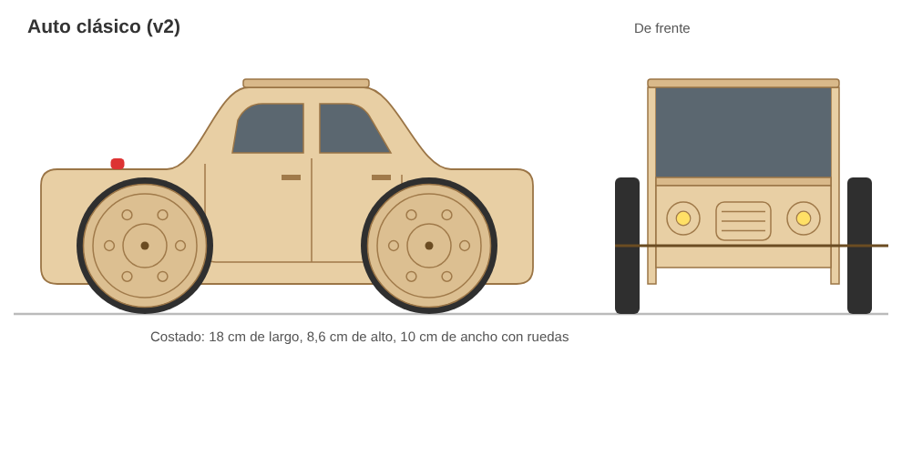

# Auto clásico con motor (diseño propio, v2)

Versión linda y de mejor calidad del auto con motor y goma. La electrónica va
escondida adentro de la carrocería. **Prototipo sin probar**: el primer corte es
para ajustar medidas.

## Archivos
- `auto-clasico.svg`: archivo para el láser. Hoja de **40 x 30 cm**, material 3 mm.
  **Rojo = cortar**, **azul = grabar**. El borde gris punteado no se corta.
- `como-se-ve.svg` / `como-se-ve.png`: cómo queda armado (no se corta).
- `vista-previa.png`: imagen de la plantilla.
- `generar.py`: arma los dos SVG. Si el material no mide 3 mm justos, se corre
  `python3 generar.py 2.8` (con el espesor real) y se ajustan todas las ranuras.

## Medidas del auto armado
18 cm de largo, 8,6 cm de alto y 10 cm de ancho con las ruedas.

## Lo que lo hace más lindo que la v1
- Carrocería con forma de auto, **ventanillas caladas** (se ve el motor por adentro).
- Puertas, manijas, parrilla, faros, luces traseras y patente **grabadas**.
- Llantas con tazas grabadas y **cubiertas de goma negra** en una canaleta.
- **Techo que se saca** para cambiar las pilas y mostrar el mecanismo.
- Agujeros para **2 faros LED** (opcional, para una versión con luces).
- Ensambla con encastres, casi sin pegamento.

## Piezas (30)
| Pieza | Cant. |
|---|---|
| Costados (izq. y der., uno es espejo del otro) | 2 |
| Piso, capó, baúl | 3 |
| Frente (parrilla y faros) y cola (luces y patente) | 2 |
| Techo + 2 guías que se pegan abajo | 3 |
| Soporte del motor | 1 |
| Ruedas: 4 tapas grabadas + 4 interiores (Ø 50) + 4 discos del medio (Ø 44) | 12 |
| Polea: 2 discos de Ø 36 + 1 de Ø 28 | 3 |
| Arandelas (separan la rueda de la carrocería) | 4 |

## Componentes por kit
- Motor DC 3 V tipo 130 (cuerpo de 20 x 15 mm).
- Portapilas 2xAA con cables.
- Pulsador con traba de 12 mm.
- 2 bornes a presión tipo Wago.
- 2 varillas de madera de 3 mm x 100 mm (o palitos de brochette).
- 4 o-rings de goma de 44 x 3 mm (cubiertas). Se consiguen en casas de
  repuestos o hidráulica. Si no, gomitas negras.
- 1 gomita de silicona para el pelo (transmisión).
- Cola vinílica.

## Calidad del material y la terminación
- **Mejor:** terciado o multilaminado de 3 mm (abedul o guatambú). Se ve madera
  de verdad y el grabado queda lindo. **Más barato:** MDF / fibrofácil de 3 mm.
- Lijar los cantos quemados con lija 220.
- Terminar con **barniz al agua** o cera de abejas. Si se pinta, usar
  acrílico al agua (no tóxico).

## Armado
1. Pegar las ruedas: tapa grabada + disco del medio + interior. Poner el o-ring
   en la canaleta.
2. Pegar la polea: 36 + 28 + 36.
3. Pegar las 2 guías abajo del techo, a 0,3 mm de cada borde largo.
4. Encastrar el piso, el capó, el baúl, el frente y la cola en un costado, y
   cerrar con el otro costado.
5. Poner el motor sobre el piso y calzar el soporte del motor encima.
6. Pasar el eje trasero por los costados y meter la polea por adentro, alineada
   con el eje del motor. Pasar la gomita por el eje del motor y la polea.
7. Pasar el eje delantero.
8. Poner arandela + rueda en cada punta de eje, a presión.
9. Pegar el portapilas con doble faz y poner el pulsador en el agujero del capó.
10. Cablear: pila (+) → botón → motor → pila (−), con los bornes. Poner el techo.

## Para probar en el primer corte
- **Ranuras:** si quedan flojas o no entran, regenerar con el espesor real
  (`python3 generar.py 2.8`, por ejemplo).
- **Pulsador (12,5 mm) y hueco del motor (20,4 x 15,4):** medir lo comprado.
- **Ruedas:** el agujero de 2,8 mm tiene que ajustar firme en la varilla de 3 mm.
- Si el auto va para atrás, dar vuelta los cables del motor.
