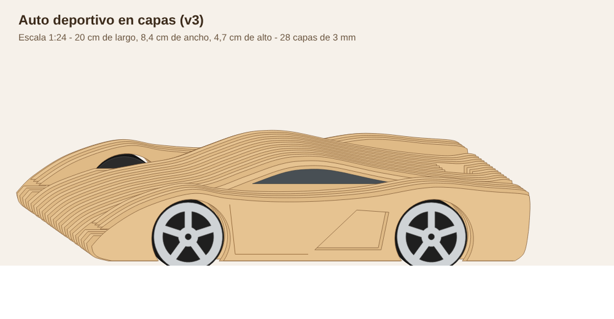

# Auto deportivo en capas (diseño propio, v3)

Superauto en cuña, inspirado en los deportivos italianos (sin copiar ningún modelo
ni usar marcas o logos). **Escala 1:24**: 20 cm de largo, 8,4 cm de ancho y 4,7 cm
de alto, el tamaño de un auto de colección. **Prototipo sin probar.**

## Cómo está hecho
La carrocería son **28 capas de 3 mm** con el perfil del auto, pegadas una al lado
de la otra. Cada capa tiene una forma un poco distinta, y así el auto queda en 3D:
- **Capas de afuera (5 por lado):** guardabarros marcados arriba de las ruedas,
  hueco de rueda, **toma de aire lateral** y ranuras de faros y luces traseras.
- **Capas del centro (18):** cabina más angosta, con el **vidrio grabado oscuro**
  en la capa de afuera. Adentro tienen los huecos de las pilas, el motor, la goma,
  la polea y el botón.
- **La tapa se levanta** (techo y cubierta del motor) para cambiar las pilas y ver
  cómo funciona por dentro. Las capas de la tapa llevan una "T" (T6 a T23).
- **Ruedas de 3 capas:** llanta de 5 rayos calada, disco del medio grabado oscuro
  (parece un disco de freno) y o-ring de goma como cubierta.

## Archivos para mandar a cortar
- `hoja-1.svg` + `hoja-1.dxf` y `hoja-2.svg` + `hoja-2.dxf`: 2 hojas de
  **60 x 40 cm** de MDF o terciado de 3 mm. Mandá los SVG o los DXF, lo que pida
  el taller.
  - **Rojo / capa CORTAR:** cortar.
  - **Azul / capa GRABAR:** grabado de línea (números, puerta).
  - **Azul relleno / capa GRABAR_RELLENO:** grabado lleno (vidrios y discos de rueda).
  - **Gris:** notas para vos, no se graban.
- Datos para pedir presupuesto: **unos 23 m de corte** en total, más los grabados.
  En un láser común son unos 25 a 35 minutos por auto (estimación).
- `vista-3d.png`, `vista-lateral.png`: para mirar (no se cortan).
- `generar.py`: arma todo de nuevo. Si el material no mide 3 mm justos:
  `pip install shapely ezdxf` y después `python3 generar.py 2.8` (con el espesor real).

## Piezas (70)
- 28 capas de carrocería, numeradas de 1 (lado izquierdo) a 28 (lado derecho).
  Las capas 15 a 19 vienen en dos partes (a y b) porque la polea pasa por ahí.
- 18 capas de tapa (T6 a T23).
- 12 discos de rueda, 3 discos de polea y 4 arandelas.
- Las piezas marcadas **"(espejo)"** (28 y T23) se cortan al revés: al armarlas
  se dan vuelta para que el grabado quede hacia afuera.

## Componentes por kit
| Componente | Para qué |
|---|---|
| Motor DC 3 V tipo 130 (20 x 15 x 25 mm, eje de 2 mm) | Mueve el auto |
| Portapilas 2xAA con cables (de 58 x 32 x 15 mm o menos) | Energía |
| Pulsador con traba de 12 mm | Prender y apagar |
| 2 bornes sin soldar (tipo Wago 221 o mini de palanca) | Unir los cables |
| 4 o-rings de 31 x 3 mm (37 mm exterior) | Cubiertas |
| 1 gomita de silicona chica | Transmisión motor a polea |
| Varillas o palitos de brochette de 3 mm | 2 ejes de 78 mm + pernos de alineación |
| Cola vinílica | Pegar las capas |

## Armado (resumen)
1. Pegar las ruedas: llanta + disco del medio + disco interior, y poner el o-ring.
   Pegar la polea: 21 + 18 + 21 mm.
2. Apilar las capas **1 a 28** en orden, usando las varillas como pernos para que
   queden alineadas. Poner cola entre capa y capa. **Las piezas T no se pegan a
   las de abajo:** se pegan solo entre ellas y forman la tapa.
3. Antes de cerrar las capas 15 a 19, meter el eje trasero con la polea, y poner
   el botón en su hueco (capas 12 a 17, atrás).
4. Poner el motor en su hueco, la gomita del eje del motor a la polea, y el
   portapilas y los bornes en el hueco grande.
5. Cablear: pila (+) → botón → motor → pila (−).
6. Meter los ejes, poner una arandela y una rueda en cada punta, a presión.
7. Lijar los cantos (lija 220) y dar barniz al agua o cera.

## Para probar en el primer corte
- **Espesor:** si las capas no dan 84 mm de ancho total, regenerar con el espesor real.
- **Peso:** en MDF el auto pesa unos 300 g sin pilas. Si el motor 130 no lo mueve
  bien, probar en terciado (más liviano) o ahuecar más el interior.
- **Pulsador y motor:** medir los comprados antes de cortar. El botón se calza a
  presión entre las capas.
- Si el auto va para atrás, dar vuelta los cables del motor.

## Ojo con las marcas
Para vender, no usar nombres ni logos de Lamborghini, Ferrari ni de ningún otro
fabricante. El diseño es propio y genérico, "estilo superauto".
